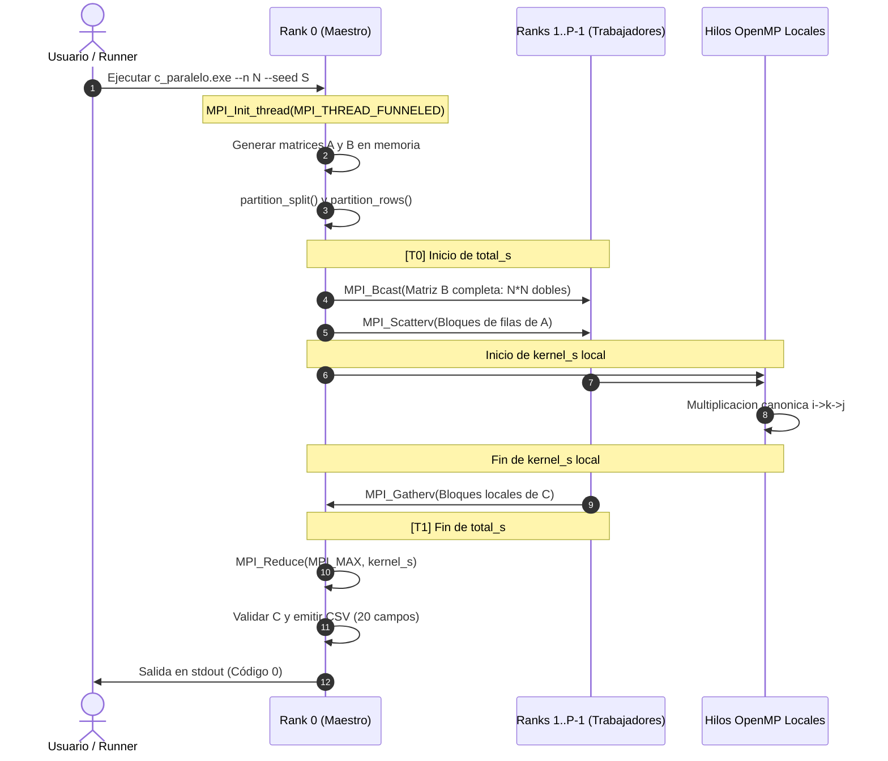
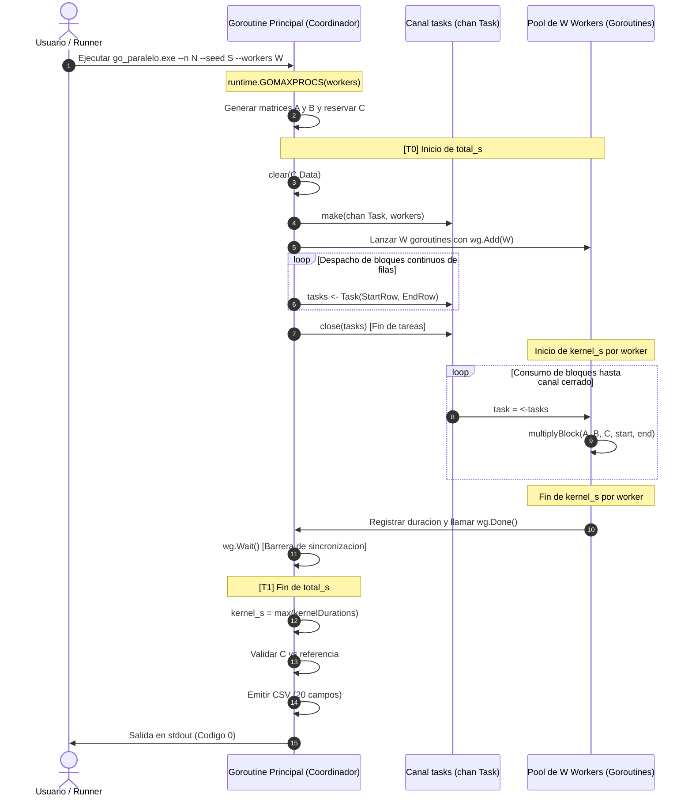

# Arquitectura de las Versiones Paralelas: C (MPI + OpenMP) y Go (Goroutines + Canales

**Sprint:** 6
**Autor:** Integrante 8 — Roberto
**Rama:** `feature/s06-i08-diseno-optimizaciones`

---

## 1. Visión General y Paradigmas de Paralelismo

El objetivo central del proyecto es diseñar, implementar y comparar dos paradigmas fundamentales de computación paralela y concurrente para resolver la multiplicación de matrices densas cuadradas $C = A \times B$ de orden $N \times N$, sobre arquitectura multinúcleo x86_64 bajo Windows 11:

```
                               ARQUITECTURAS DEL PROYECTO
                                           │
         ┌─────────────────────────────────┴─────────────────────────────────┐
         ▼                                                                   ▼
   c_paralelo (Híbrido)                                            go_paralelo (CSP Concurrente)
   ┌───────────────────────────────────────────────┐               ┌───────────────────────────────────────────────┐
   │ Memoria Distribuida (MPI):                    │               │ Memoria Compartida (Go Runtime):              │
   │  • P procesos del S.O.                        │               │  • Pool acotado de W goroutines               │
   │  • Comunicación vía mensajes colectivos       │               │  • Planificador M:N sobre GOMAXPROCS hilos    │
   │  • Particionado 1D por bloques de filas       │               │  • Despacho por canal tipado chan Task        │
   │ Memoria Compartida (OpenMP):                  │               │ Sincronización y Propiedad:                   │
   │  • T hilos locales por proceso                │               │  • Sincronización limpia con sync.WaitGroup   │
   │  • Paralelismo de bucles (#pragma omp)        │               │  • Propiedad disjunta de escritura en C       │
   │  • Modo MPI_THREAD_FUNNELED                   │               │  • A y B solo lectura (cero data races)       │
   └───────────────────────────────────────────────┘               └───────────────────────────────────────────────┘
```

### Principios Rectores Comunes

1. **Representación de Datos:** Almacenamiento contiguo por filas (_row-major layout_) donde el elemento $(i, j)$ reside en la posición lineal $i \times N + j$. En C se utiliza `double` (64 bits, IEEE 754) y en Go `float64`.
2. **Núcleo Aritmético Canónico:** Orden de bucles $i \to k \to j$ en ambas implementaciones. Al fijar el elemento $A[i, k]$ en un registro/variable temporal, los accesos a las filas de $B$ y $C$ se realizan de forma estrictamente secuencial ($j$ consecutivo), maximizando la tasa de aciertos (_cache hits_) en las líneas de caché L1/L2.
3. **Propiedad Exclusiva de Escritura:** Cada celda $C[i, j]$ es modificada por exactamente un hilo o worker. No se requieren primitivas de exclusión mutua de grano fino (como mutex o bloqueos atómicos) en la sección crítica aritmética.
4. **Inmutabilidad de Entradas:** Las matrices $A$ y $B$ permanecen en solo lectura durante toda la computación; no sufren modificaciones ni se produce solapamiento destructivo (_buffer aliasing_).
5. **Separación de Intervalos Temporales:** Aislamiento estricto de `kernel_s` (tiempo de cómputo aritmético puro) frente a `total_s` (que incorpora vaciado de memoria, distribución de mensajes, despacho por canales y sincronización colectiva).

---

## 2. Arquitectura de C Paralelo (`c_paralelo`): Híbrido MPI + OpenMP

### 2.1. Modelo Jerárquico de Ejecución

La solución combina el paso de mensajes entre procesos independientes (**MPI**) con el paralelismo multihilo en memoria compartida (**OpenMP**), implementando el modelo jerárquico híbrido:

- **Nivel 1 (Entre Procesos - MPI):** El problema global se divide en $P$ procesos del sistema operativo comunicados mediante MS-MPI. El proceso maestro (`rank 0`) lee o genera las matrices, coordina la distribución y reúne los resultados.
- **Nivel 2 (Intra-proceso - OpenMP):** Cada proceso MPI utiliza $T$ hilos de ejecución OpenMP para computar su bloque asignado de filas en paralelo.
- **Nivel de Hilos MPI (`MPI_THREAD_FUNNELED`):** La inicialización se realiza con `MPI_Init_thread(..., MPI_THREAD_FUNNELED, &provided)`. Únicamente el hilo principal (_master thread_) de cada proceso ejecuta llamadas a funciones MPI, garantizando compatibilidad absoluta y ausencia de contención en la pila de red.

### 2.2. Particionado 1D por Bloques de Filas (`partition.h`)

Para repartir $N$ filas entre $P$ procesos cuando $N$ no es múltiplo exacto de $P$, se utiliza el algoritmo de cociente y resto en forma cerrada:

$$
q = \lfloor N / P \rfloor, \quad r = N \bmod P
$$

$$
\text{filas}[i] = q + \begin{cases} 1 & \text{si } i < r \\ 0 & \text{si } i \ge r \end{cases}
$$

$$
\text{primera}[i] = i \times q + \min(i, r)
$$

#### Invariantes Estructurales de Partición:

- **I1:** $\text{filas}[i] \ge 0 \quad \text{y} \quad \sum_{i=0}^{P-1} \text{filas}[i] = N$.
- **I2:** $\text{primera}[0] = 0$.
- **I3:** $\text{primera}[i+1] = \text{primera}[i] + \text{filas}[i]$ (bloques contiguos sin solapamiento ni huecos).
- **I4:** $\text{counts}[i] = \text{filas}[i] \times N$ (cantidad de elementos `double` transferidos por proceso).
- **I5:** $\text{displs}[i] = \text{primera}[i] \times N$ (desplazamiento en elementos dentro de la matriz plana).
- **I6:** $\sum_{i=0}^{P-1} \text{counts}[i] = N \times N$.
- **Soporte de $P > N$:** Si hay más procesos que filas ($q = 0, r = N$), los primeros $N$ procesos reciben 1 fila y los $P - N$ restantes reciben 0 filas (`counts[i] = 0`). La norma MPI estipula que `count = 0` es legal y no bloquea las llamadas colectivas.
- **Límite por Aritmética de Enteros:** Como los desplazamientos y conteos de MPI son enteros con signo (`int`), se exige $N \times N \le 2^{31}-1$ (`INT_MAX`), lo que define el límite arquitectónico $N \le 46340$ ($\approx 17\text{ GB}$ por matriz en RAM).

### 2.3. Flujo de Datos y Comunicación Colectiva MPI

El intercambio de datos entre el proceso raíz (`rank 0`) y los procesos trabajadores se efectúa mediante tres operaciones colectivas sincronizadas:

```
                                 FLUJO DE COMUNICACIÓN MPI

       Proceso 0 (Raíz)                                          Procesos 0 .. P-1
   ┌───────────────────────┐                                   ┌───────────────────────┐
   │ Matriz A completa     │                                   │                       │
   │ Matriz B completa     │                                   │                       │
   └──────────┬────────────┘                                   └──────────┬────────────┘
              │                                                           │
              ├─────── MPI_Bcast(Matriz B completa: N*N elementos) ───────┤
              │        (Todos los procesos reciben la matriz B completa)  │
              │                                                           │
              ├─────── MPI_Scatterv(Matriz A: counts[], displs[]) ────────┤
              │        (Cada proceso i recibe filas[i]*N elementos de A)  │
              │                                                           ▼
              │                                                ┌───────────────────────┐
              │                                                │ Cálculo Local OpenMP  │
              │                                                │ #pragma omp parallel  │
              │                                                │ local_c = local_a * B │
              │                                                └──────────┬────────────┘
              │                                                           │
              ├─────── MPI_Gatherv(local_c: counts[], displs[]) ──────────┤
              │        (Proceso 0 recolecta los bloques locales de C)     │
              ▼                                                           ▼
   ┌───────────────────────┐                                   ┌───────────────────────┐
   │ Matriz C completa     │                                   │ local_c liberado      │
   │ Validación y CSV      │                                   │ Espera en MPI_Finalize│
   └───────────────────────┘                                   └───────────────────────┘
```

1. **Difusión Global de $B$ (`MPI_Bcast`):** Toda la matriz $B$ ($N \times N$ elementos `double`) se difunde a todos los procesos del comunicador `MPI_COMM_WORLD`. Como todos los procesos necesitan columnas completas de $B$, la difusión asegura que cada proceso disponga de $B$ localmente sin transferencias punto a punto adicionales.
2. **Distribución Segmentada de $A$ (`MPI_Scatterv`):** El proceso 0 dispersa la matriz $A$ según el vector `counts` y `displs`. El proceso $i$ almacena su porción en un buffer local continuo `local_a` de tamaño $\text{filas}[i] \times N$.
3. **Recolección Segmentada de $C$ (`MPI_Gatherv`):** Tras completar la multiplicación local, cada proceso envía su buffer continuo `local_c` ($\text{filas}[i] \times N$ dobles). El proceso 0 reconstruye la matriz $C$ en el buffer global ordenado.

### 2.4. Paralelismo Multihilo Local con OpenMP

En cada proceso con $\text{filas}[\text{rank}] > 0$, el cálculo del producto se
distribuye entre los hilos del proceso mediante directivas OpenMP. El fragmento
siguiente es esquemático: `matrix_accumulate_rows` usa una región `omp parallel`,
un `omp single` para observar el número de hilos y `omp for schedule(static)`
para repartir las filas, con barrera implícita al finalizar.

```c
#pragma omp parallel for schedule(static)
for (int i = 0; i < local_rows; ++i) {
    const double *a_row = local_a + (size_t)i * n;
    double *c_row = local_c + (size_t)i * n;
    for (int k = 0; k < n; ++k) {
        const double a_ik = a_row[k];
        const double *b_row = b + (size_t)k * n;
        for (int j = 0; j < n; ++j) {
            c_row[j] += a_ik * b_row[j];
        }
    }
}
```

- **`schedule(static)`:** Distribuye las filas locales en bloques uniformes entre los hilos de manera determinista, minimizando la sobrecarga de despacho dinámico.
- **Aislamiento de Variables:** Las variables de control de bucle `i`, `k`, `j` y el escalar `a_ik` se declaran `private` por hilo en la pila (_thread stack_). Los punteros de matriz `local_a`, `b` y `local_c` son `shared`.
- **Cero Colisiones de Escritura:** Dado que el bucle paralelizado es el exterior (`i`), cada hilo opera en un conjunto disjunto de filas de `local_c`. Dos hilos jamás acceden a la misma posición de memoria en escritura.

### 2.5. Delimitación Temporal en C Paralelo

- **`kernel_s`:** Intervalo medido exclusivamente alrededor del bloque de cálculo OpenMP (`local_rows > 0`). El proceso raíz recopila mediante `MPI_Reduce` con operador `MPI_MAX` el tiempo del proceso más lento:
  $$
  \text{kernel}_s = \max_{p \in [0, P-1]} (\text{kernel}_{s, p})
  $$
- **`total_s`:** Cada proceso mide desde antes de `MPI_Bcast` y `MPI_Scatterv`
  hasta después de `MPI_Gatherv`, incluyendo el vaciado local y el cálculo.
  El proceso 0 recibe el máximo de estos tiempos mediante `MPI_Reduce(MPI_MAX)`,
  fuera del intervalo medido. La reserva de memoria y la barrera inicial quedan
  fuera de `total_s`.

---

## 3. Arquitectura de Go Paralelo (`go_paralelo`): Goroutines y Canales

### 3.1. Modelo CSP (Communicating Sequential Processes)

`go_paralelo` reemplaza la memoria distribuida por un modelo de concurrencia estructurada sobre memoria compartida administrada por el runtime de Go:

- **Pool Acotado de Goroutines:** No se genera una goroutine por celda ni por fila. Se inicializa un pool fijo de exactamente $W$ workers (`--workers W`).
- **Canal Tipado de Tareas (`chan Task`):** Las goroutines trabajadoras compiten de forma pasiva por consumir tareas de un canal tipado con buffer acotado (`make(chan Task, workers)`).
- **Coordinación de Finalización:** Sincronización libre de cerrojos mediante `sync.WaitGroup` (`wg.Add`, `defer wg.Done()`, `wg.Wait()`).
- **Runtime M:N:** Se fija `runtime.GOMAXPROCS(workers)` para permitir ejecución verdaderamente simultánea sobre los hilos del sistema operativo.

### 3.2. Estructuras de Datos y Modelo de Tareas (`workers.go`)

```go
// Matrix representa una matriz cuadrada en almacenamiento continuo por filas
type Matrix struct {
    N    int
    Data []float64 // len == N*N, fila i en Data[i*N : (i+1)*N]
}

// Task delimita un intervalo contiguo de filas semi-abierto [StartRow, EndRow)
type Task struct {
    StartRow int // 0 <= StartRow < EndRow <= N
    EndRow   int
}
```

#### Particionado Dinámico por Bloques (`computeBlockSize` y `dispatchRowBlocks`):

El orquestador calcula el tamaño de bloque mediante división por exceso protegida contra desbordamientos:

```go
func computeBlockSize(n, workers int) int {
    size := n / workers
    if n%workers != 0 {
        size++
    }
    return size
}
```

- Si $W \ge N$: `size = 1`. Se generan N tareas de una fila. Cualquier worker
  puede consumirlas y un mismo worker puede ejecutar varias; no se garantiza
  que sean las primeras N goroutines ni que N workers distintos reciban trabajo.
  Todos terminan al agotar el canal cerrado y notifican `wg.Done()`.
- El productor (goroutine principal) despacha todos los bloques e inmediatamente ejecuta `close(tasks)`.

### 3.3. Ciclo de Vida del Worker y Ejecución Aritmética

```
                                 FLUJO CONCURRENTE EN GO

        Goroutine Coordinadora                                     Pool de W Workers
   ┌──────────────────────────────┐                          ┌───────────────────────────┐
   │ 1. Validar A y B             │                          │ Worker 0 (goroutine)      │
   │ 2. Reservar C (N*N doubles)  │                          │ Worker 1 (goroutine)      │
   │ 3. tasks := make(chan Task)  │                          │ ...                       │
   │ 4. wg.Add(W); lanzar workers │                          │ Worker W-1 (goroutine)    │
   └──────────────┬───────────────┘                          └─────────────┬─────────────┘
                  │                                                        │
                  ├──────── Despacho de bloques a tasks <- Task ───────────┤
                  │         (Cada bloque [StartRow, EndRow) es continuo)   │
                  │                                                        ▼
                  ├──────── close(tasks) [Señal de no más trabajo] ────────┤
                  │                                                        │
                  │                                          ┌───────────────────────────┐
                  │                                          │ for task := range tasks { │
                  │                                          │   t0 := time.Now()        │
                  │                                          │   multiplyBlock(a,b,c)    │
                  │                                          │   dur += Since(t0)        │
                  │                                          │ }                         │
                  │                                          │ kernelDurations[id] = dur │
                  │                                          │ defer wg.Done()           │
                  │                                          └─────────────┬─────────────┘
                  │                                                        │
                  ├──────── wg.Wait() [Barrera de sincronización] ─────────┤
                  ▼                                                        ▼
   ┌──────────────────────────────┐                          ┌───────────────────────────┐
   │ 5. total_s = time.Since(T0)  │                          │ Workers finalizados       │
   │ 6. kernel_s = max(durations) │                          │                           │
   │ 7. Validación numérica y CSV │                          │                           │
   └──────────────────────────────┘                          └───────────────────────────┘
```

```go
func worker(id int, tasks <-chan Task, wg *sync.WaitGroup,
    a, b, c *Matrix, kernelDurations []time.Duration) {
    defer wg.Done()
    var elapsed time.Duration
    for task := range tasks {
        start := time.Now()
        multiplyBlock(a, b, c, task.StartRow, task.EndRow)
        elapsed += time.Since(start)
    }
    kernelDurations[id] = elapsed // Escritura en slot propio disjunto
}
```

- **`multiplyBlock`:** Implementa el triple bucle $i \to k \to j$ exclusivamente en el rango $[StartRow, EndRow)$.
- **Propiedad de Memoria:** $A$ y $B$ se acceden concurrentemente sin sincronización porque son 100% de solo lectura. En $C$, cada worker escribe en su segmento disjunto $Data[StartRow \times N : EndRow \times N]$. No existe solapamiento ni carreras de datos (_race-free_).
- **Inspección Dinámica de Carreras:** `go test -race ./...` no reportó carreras
  en las ejecuciones comprobadas; la reproducción del 28/10/2026 está en el
  [cierre de S4](sprints/sprint-04.md). El detector no constituye una prueba formal
  para todas las ejecuciones posibles.

### 3.4. Delimitación Temporal en Go Paralelo

- **`kernel_s`:** Se instrumenta individualmente dentro de cada worker midiendo solo el tiempo acumulado en `multiplyBlock`. Al salir de `wg.Wait()`, la coordinadora toma el valor máximo:
  $$
  \text{kernel}_s = \max_{w \in [0, W-1]} (\text{kernelDurations}[w])
  $$
- **`total_s`:** Cronometrado por el coordinador desde el vaciado explícito de
  $C$ (`clear(c.Data)`) hasta el retorno de `wg.Wait()`, incluyendo la creación
  del canal, el lanzamiento del pool y el despacho. La reserva de buffers,
  `GOMAXPROCS`, el cálculo del máximo de tiempos, la validación y la salida
  quedan fuera del intervalo.

---

## 4. Comparación Arquitectónica: C Paralelo vs Go Paralelo

| Dimensión Técnica                       | C Paralelo (`c_paralelo`)                                | Go Paralelo (`go_paralelo`)                                                                           |
| :-------------------------------------- | :------------------------------------------------------- | :---------------------------------------------------------------------------------------------------- |
| **Paradigma Principal**                 | Paso de mensajes distribuido + Hilos nativos             | Concurrencia CSP basada en canales + Goroutines                                                       |
| **Tecnologías**                         | MS-MPI (v10+) + OpenMP (C11, MSVC x64)                   | Go Runtime nativo (Go 1.27+ `windows/amd64`)                                                          |
| **Espacio de Direcciones**              | $P$ procesos con memoria aislada (distribuida)           | 1 proceso con heap único compartido                                                                   |
| **Distribución de Matriz $A$**          | `MPI_Scatterv` (bloques contiguos por filas)             | `chan Task` (despacho de bloques de filas)                                                            |
| **Distribución de Matriz $B$**          | `MPI_Bcast` (réplica completa en cada proceso)           | Memoria compartida global (solo lectura sin copia)                                                    |
| **Recolección de Matriz $C$**           | `MPI_Gatherv` (reconstrucción en rank 0)                 | Escritura directa en slice `C.Data`                                                                   |
| **Granularidad de Hilos**               | $T$ hilos OS del sistema operativo por proceso           | $W$ goroutines ligeras mapeadas por scheduler M:N                                                     |
| **Sincronización**                      | Colectivas bloqueantes (`MPI_Bcast`, `MPI_Gatherv`)      | Canal tipado + `sync.WaitGroup`                                                                       |
| **Sobrecarga de Comunicación**          | Serialización y copia por sockets/memoria compartida IPC | Cero copia de datos; solo paso del descriptor `Task` (16 bytes)                                       |
| **Prevención de Data Races**            | Procesos aislados; OpenMP privatiza índices $i,k,j$      | Rango de filas disjunto en $C$; $A, B$ solo lectura                                                   |
| **Comportamiento si $P > N$ o $W > N$** | Procesos extra reciben `count=0` sin fallos              | N tareas de una fila; el reparto entre workers depende del planificador y todos notifican `wg.Done()` |
| **Escalabilidad Teórica**               | Escala a clústeres multi-nodo y supercomputadores        | Escala eficientemente dentro de un nodo simétrico (SMP/NUMA)                                          |

---

## 5. Mapeo a la Rúbrica de Evaluación y Criterios Académicos

En conformidad con las pautas de evaluación del curso de **Programación Concurrente y Paralela**, las dos arquitecturas satisfacen los siguientes pilares de rigor:

### 5.1. Corrección Matemática y Determinismo Numérico

- **Tolerancia Universal:** Ambas referencias implementan la regla estricta de validación celda a celda contra fixtures de control (`tests/fixtures/`):
  $$
  |C_{\text{obtenido}} - C_{\text{esperado}}| \le 10^{-9} + 10^{-9} \cdot |C_{\text{esperado}}|
  $$
- **Generación Idéntica:** El generador pseudoaleatorio congruencial lineal (LCG) genera matrices idénticas bit a bit en C y Go partiendo de la misma semilla (`--seed`).

### 5.2. Seguridad Concurrente y Ausencia de Anomalías

- **Ausencia de Deadlocks:**
  - En C: las llamadas colectivas (`Bcast`, `Scatterv`, `Gatherv`) son invocadas en idéntico orden y cardinalidad por todos los procesos de `MPI_COMM_WORLD`.
  - En Go: el productor asegura `close(tasks)` únicamente tras despachar la totalidad de los bloques, permitiendo que todos los workers salgan del bucle `for task := range tasks`.
- **Ausencia de Data Races:**
  - En C: ningún hilo OpenMP comparte índices de fila de escritura.
  - En Go: garantizado por diseño e inspección estática y dinámica con `go test -race`.

### 5.3. Rigor del Protocolo Experimental

- **Aislamiento de Cronometraje:** La lectura de archivos, validación sintáctica de flags, generación de matrices y emisión de salidas CSV se ejecutan fuera de los cronómetros.
- **Separación `kernel_s` vs `total_s`:** Permite calcular el _overhead_ de paralelización ($\text{Sobrecarga} = \text{total}_s - \text{kernel}_s$), revelando el costo de la comunicación de red/IPC en MPI frente a la contención del planificador en Go.

---

## 6. Diagramas de Flujo y Secuencia

### 6.1. Secuencia de Comunicación en C Paralelo (`c_paralelo`)



### 6.2. Secuencia de Concurrencia en Go Paralelo (`go_paralelo`)



---

## 7. Invariantes de Correctitud Globales

| Invariante | Descripción                                                                         | Implementación en C (`c_paralelo`)                                                   | Implementación en Go (`go_paralelo`)                                                       |
| :--------: | :---------------------------------------------------------------------------------- | :----------------------------------------------------------------------------------- | :----------------------------------------------------------------------------------------- |
| **INV-01** | **Cobertura Completa:** Toda fila $i \in [0, N-1]$ se calcula exactamente una vez.  | Garantizado por `partition_split`: $\sum \text{filas}[i] = N$ y bloques adyacentes.  | Garantizado por `dispatchRowBlocks`: bloques contiguos disjuntos cubren $[0, N)$.          |
| **INV-02** | **Aislamiento de Escritura:** Ningún hilo/proceso sobreescribe memoria de otro.     | Cada proceso escribe en su `local_c`; OpenMP particiona el bucle exterior $i$.       | Cada worker escribe en $C[StartRow \times N : EndRow \times N]$; no hay solapamiento.      |
| **INV-03** | **Inmutabilidad de Entrada:** $A$ y $B$ no sufren alteraciones durante el cómputo.  | Punteros `const double *` en OpenMP; buffers independientes.                         | Slices $A$ y $B$ tratados como solo lectura; verificado con `reflect.DeepEqual`.           |
| **INV-04** | **Terminación Garantizada:** Ausencia de bloqueos (_deadlocks_) en sincronización.  | Mismo orden de colectivas MPI en todos los procesos; $P > N$ manejado con `count=0`. | `close(tasks)` ejecutado tras despachar todo; workers salen del `range` y llaman `Done()`. |
| **INV-05** | **Robustez Numérica:** Rechazo inmediato ante valores no finitos o desbordamientos. | Validación con `isfinite()`; control de $N \le 46340$ en `partition_rows`.           | Validación con `math.IsNaN()` / `math.IsInf()`; error explícito `ErrNonFiniteValue`.       |

---

## 8. Trazabilidad con la Guía del Proyecto y Entregables

- **`c_paralelo/include/partition.h`:** Contrato matemático de particionado 1D (Sebastian, S2).
- **`c_paralelo/src/main.c` y `partition.c`:** Orquestación de llamadas colectivas MPI (Yessly, S4).
- **`c_paralelo/src/matrix.c`:** Computación local con OpenMP (Sebastian, S4).
- **`go_paralelo/workers.go` y `matrix.go`:** Pool de goroutines, canal tipado y `multiplyBlock` (Giuliano, S4).
- **`go_paralelo/main.go`:** Integración de CLI, temporizadores y CSV (Eva, S4).
- **`docs/protocolo_medicion.md`:** Protocolo oficial de cronometraje y esquema CSV de 20 campos (Andrés, S2).
- **`docs/bibliografia.md`:** Fundamento teórico de localidad de caché y particionado por filas (Roberto, S2).
- **`docs/validacion_independiente.md`:** Acta de validación independiente en segunda PC física (Roberto, S5).

---

## 9. Fundamentación Teórica desde la Literatura Científica (Sprint 6)

En el marco del **Sprint 6** ("_Optimizar con evidencia_"), las decisiones de arquitectura y optimización adoptadas en el proyecto se fundamentan y contrastan directamente con la literatura científica clásica y contemporánea revisada en `docs/bibliografia.md`:

### 9.1. Jerarquía de Memoria y Localidad de Caché (Hennessy & Patterson, Dongarra et al.)

En procesadores modernos de arquitectura x86_64 (como AMD Zen 4 o Intel Core), la memoria caché organiza las transferencias desde la memoria principal (DRAM) en **líneas de caché de 64 bytes**. Dado que cada elemento `double` en C y `float64` en Go ocupa 8 bytes, una sola línea de caché transfiere exactamente **8 elementos flotantes contiguos**.

```
              LÍNEA DE CACHÉ DE 64 BYTES (8 FLOATS DE 64 BITS)
  ┌──────────┬──────────┬──────────┬──────────┬──────────┬──────────┬──────────┬──────────┐
  │ Val[k,0] │ Val[k,1] │ Val[k,2] │ Val[k,3] │ Val[k,4] │ Val[k,5] │ Val[k,6] │ Val[k,7] │
  └──────────┴──────────┴──────────┴──────────┴──────────┴──────────┴──────────┴──────────┘
  ◄────────────────────────────────── 64 Bytes ──────────────────────────────────────────►
```

#### Análisis Comparativo de las Permutaciones de Bucles:

Para la multiplicación de matrices densas $N \times N$ en almacenamiento contiguo por filas (_row-major_):

- **Orden de Texto Escolar ($i \to j \to k$):**
  - Para calcular una sola celda $C[i, j]$, el bucle más interno varía el índice $k$:
    $$
    C[i, j] += A[i, k] \times B[k, j]
    $$
  - Mientras $A[i, k]$ avanza secuencialmente (stride-1), el acceso a $B[k, j]$ salta filas completas: posición $(k \times N + j)$, con un paso de memoria (_stride_) de $N$ elementos ($8N$ bytes).
  - Cuando $N$ supera el tamaño de una línea de caché (es decir, $N > 8$), cada iteración sobre $k$ provoca un **fallo de caché forzado (_cache miss_)** sobre $B$. Esto destruye el rendimiento y satura el bus de memoria.
- **Orden Canónico Optimizado ($i \to k \to j$):**
  - Al intercambiar los bucles $j$ y $k$:
    - En el bucle intermedio $k$, el valor escalar $a_{ik} = A[i, k]$ se carga **una sola vez** en un registro de CPU (localidad temporal perfecta).
    - En el bucle más interno $j$, se ejecutan accesos contiguos en memoria tanto para la fila $k$ de $B$ ($B[k \times N + j]$) como para la fila $i$ de $C$ ($C[i \times N + j]$).
    - **Stride-1 Absoluto:** Ambos accesos avanzan celda a celda contigua ($j, j+1, j+2, \dots$). El primer acceso carga la línea de 64 bytes completa a la caché L1, y las 7 iteraciones siguientes resultan en **aciertos de caché inmediatos (_cache hits_)** a velocidad de registro/L1.
    - Además, los mecanismos de _Hardware Prefetcher_ del CPU detectan el patrón lineal y anticipan la carga de las siguientes líneas de caché antes de que sean solicitadas.
  - **Conclusión Teórica:** El orden $i \to k \to j$ aprovecha al máximo la jerarquía de memoria sin requerir código ensamblador ni transformaciones complejas de datos.

### 9.2. Particionado Jerárquico: H-SUMMA (Quintin & Wagner, 2013)

En su investigación sobre multiplicación jerárquica de matrices (_H-SUMMA: A Hierarchical Approach to Matrix Multiplication_), Quintin y Wagner demuestran que en sistemas con comunicación híbrida (red entre nodos + memoria compartida en el nodo), la clave de la escalabilidad radica en **minimizar las transferencias globales de comunicación**:

- En nuestro híbrido C (`c_paralelo`), el particionado 1D por bloques de filas (`partition.h`) implementa este principio de dos niveles:
  - **Nivel Colectivo (MPI):** El proceso maestro difunde la matriz $B$ una sola vez mediante `MPI_Bcast` y dispersa $A$ mediante `MPI_Scatterv`. Durante el cálculo aritmético no existe ninguna comunicación inter-proceso ni contención de red.
  - **Nivel Local (OpenMP):** Los hilos locales operan exclusivamente sobre la porción de memoria local (`local_a` y `local_c`), maximizando la independencia de cómputo.
- **Ventaja del Particionado 1D sobre el 2D (Cannon / SUMMA Estándar):**
  - Los esquemas 2D (grillas de procesos $\sqrt{P} \times \sqrt{P}$) requieren empaquetar bloques bidimensionales no continuos de memoria (_data packing/unpacking_) o tipos derivados de MPI (`MPI_Type_vector`), introduciendo sobrecostes de serialización.
  - En contraposición, en el almacenamiento _row-major_, un bloque continuo de filas completas es un subarreglo estrictamente contiguo en memoria. `MPI_Scatterv` y `MPI_Gatherv` transfieren los datos directamente sin copias intermedias ni reordenamientos.

### 9.3. Modelo de Concurrencia CSP (Hoare, 1978; Golani et al., 2021)

La implementación de `go_paralelo` traduce los principios del formalismo CSP (_Communicating Sequential Processes_):

- En lugar de compartir memoria mediante cerrojos (_locks_) o variables de condición que degradan la escalabilidad, se utiliza un canal tipado `chan Task` donde cada tarea encapsula la propiedad exclusiva de un bloque continuo de filas $[StartRow, EndRow)$.
- Los workers consumen tareas de forma pasiva, garantizando balanceo dinámico natural sin sobrecarga de gestión centralizada.
- La inmutabilidad de $A$ y $B$ y la ausencia de escrituras compartidas en $C$ aseguran matemáticamente la ausencia de condiciones de carrera (_race freedom_), verificado exhaustivamente mediante el detector de carreras del runtime de Go (`go test -race`).

---

## 10. Evaluación de Optimizaciones Candidatas y Decisiones de Diseño

En concordancia con el objetivo del Sprint 6 (_"Mejorar el rendimiento sin cambiar la corrección ni introducir comparaciones injustas"_), se evaluaron las siguientes técnicas de optimización:

### 10.1. Tiling o Bloques de Memoria Caché (_Cache Blocking_)

- **Hipótesis:** Dividir las matrices en sub-bloques $B_{size} \times B_{size}$ que quepan simultáneamente en la caché L1D/L2 para evitar el desalojo de líneas en matrices grandes.
- **Análisis Experimental y Literario:**
  - Para las dimensiones del proyecto ($N \in \{512, 1024, 2048, 4096\}$), el bucle canónico $i \to k \to j$ ya presenta un comportamiento óptimo porque la fila activa de $B$ y la fila acumulada de $C$ se reutilizan intensivamente.
  - El tiling requiere sextuplicar los bucles de iteración ($i_b \to k_b \to j_b \to i \to k \to j$), lo que introduce una sobrecarga considerable en la gestión de índices y penaliza el rendimiento en dimensiones que no sean múltiplos exactos del tamaño de bloque ($B_{size}$), como ocurre con matrices impares (`impar3` o $N=129$).
  - En pruebas comparativas en compiladores modernos con prefetching automático, la ganancia del tiling manual en matrices $\le 2048$ es marginal frente a la pérdida de simplicidad del código.
- **Decisión de Diseño:** **DESCARTAR el tiling manual.** Se conserva el triple bucle canónico $i \to k \to j$, garantizando simplicidad, robustez universal y equidad algorítmica.

### 10.2. Vectorización Manual SIMD (AVX2/AVX-512) vs Auto-vectorización del Compilador

- **Hipótesis:** Reemplazar el bucle interno de $j$ por instrucciones vectoriales explícitas (intrínsecos `_mm256_fmadd_pd`).
- **Análisis de Equidad:**
  - En lenguaje C es posible escribir intrínsecos de ensamblador de bajo nivel, pero en Go nativo el compilador estándar `gc` no expone intrínsecos manuales directos, obligando a recurrir a ensamblador Plan 9 (`.s`), lo que rompería la portabilidad multiplataforma y la auditabilidad del código.
  - Introducir SIMD manual en C y dejar Go con código estándar constituiría una **comparación metodológicamente asimétrica e injusta**, violando la rúbrica académica.
  - Los compiladores de C (MSVC con `/O2 /fp:precise` y GCC con `-O2`) ya reconocen el patrón $i \to k \to j$ y auto-vectorizan el bucle interno sobre $j$ utilizando registros SIMD xmm/ymm de forma segura.
- **Decisión de Diseño:** **DESCARTAR intrínsecos manuales.** Confiar exclusivamente en la optimización y auto-vectorización nativa del compilador en modo `-O2` / `Release`, preservando la equivalencia conceptual del código fuente en C y Go.

### 10.3. Granularidad del Canal y Pool de Workers en Go Paralelo

- **Hipótesis:** Variar la cantidad de tareas despachadas por el canal (por ejemplo, bloques fijos de 16 filas vs bloques calculados con división entera).
- **Análisis Experimental:**
  - Enviar bloques demasiado pequeños genera contención y sobrecoste de sincronización en el canal `chan Task` (`runtime.chansend` y `runtime.chanrecv`).
  - Enviar bloques demasiado grandes puede desbalancear la carga si un hilo se retrasa por interrupciones del sistema operativo.
  - La fórmula adoptada en Sprint 4 (`computeBlockSize(n, workers) = ceil(n / workers)`) divide la matriz en exactamente $W$ bloques contiguos balanceados. Como cada worker recibe un bloque sustancial y el canal se dimensiona con buffer `make(chan Task, workers)`, el productor despacha todas las tareas sin bloquearse y el canal se cierra de inmediato.
- **Decisión de Diseño:** **CONSERVAR el particionado contiguo por bloques** con buffer acotado y límite estricto `MaxWorkers = 1024`.

### 10.4. Gestión de Memoria y Prevención de Fugas

- **Decisión de Diseño:** Toda reserva de memoria (`malloc` en C, `make` en Go) debe realizarse **antes** del inicio del cronómetro $T_0$, y la liberación o recolección de basura después del fin del cronómetro $T_1$.
- El vaciado explícito de memoria de la matriz $C$ (mediante `memset` en C o `clear(c.Data)` en Go) se realiza dentro de `total_s` pero **estrictamente fuera de `kernel_s`**, garantizando que el kernel mida exclusivamente la computación aritmética útil.

---

## 11. Criterios Formales para el Congelamiento del Algoritmo (Algorithmic Freezing)

Con el fin de asegurar la reproducibilidad, comparabilidad y rigor científico en las campañas experimentales y estadísticas de los **Sprints 7 y 8**, el equipo establece el siguiente **Marco Normativo de Congelamiento Algorítmico**:

```
                         CRITERIOS DE CONGELAMIENTO ALGORÍTMICO
 ┌──────────────────────────────────────────────────────────────────────────────────┐
 │                                                                                  │
 │   1. EQUIDAD ALGORÍTMICA                                                         │
 │      • Mismo orden canónico de bucles i -> k -> j en las 4 versiones.            │
 │      • Exactamente 2*N^3 operaciones flotantes (FLOPs) ejecutadas.               │
 │      • Sin intrínsecos manuales asimétricos entre lenguajes.                     │
 │                                                                                  │
 │   2. DETERMINISMO Y TOLERANCIA NUMÉRICA                                          │
 │      • Preservación estricta de tolerancia: |C_c - C_e| <= 1e-9 + 1e-9*|C_e|.    │
 │      • Identidad exacta bit a bit en los 5 fixtures canónicos oficiales.         │
 │      • Rechazo determinista e inmediato ante NaN o infinitos.                    │
 │                                                                                  │
 │   3. INVARIANTES DE MEMORIA Y SEGURIDAD CONCURRENTE                              │
 │      • Almacenamiento continuo por filas (row-major).                            │
 │      • Propiedad disjunta: un único escritor por celda (cero data races).        │
 │      • Matrices A y B tratadas como solo lectura estricta.                       │
 │                                                                                  │
 │   4. RIGOR DE CRONOMETRÍA                                                        │
 │      • Invariante temporal inviolable: 0.0 <= kernel_s <= total_s.               │
 │      • I/O, generación de matrices, parseo y validación FUERA de cronómetros.    │
 │      • Emisión obligatoria del esquema CSV unificado de 20 columnas.             │
 │                                                                                  │
 └──────────────────────────────────────────────────────────────────────────────────┘
```

### Reglas de Congelamiento:

1. **Regla de Inmutabilidad del Algoritmo:** A partir del cierre del Sprint 6, queda estrictamente prohibido alterar la lógica interna de acumulación o el orden de iteración de los núcleos secuenciales y paralelos.
2. **Regla de Modificación Justificada:** Ninguna propuesta de cambio de código podrá integrarse a `main` a menos que demuestre:
   - Medición experimental rigurosa de _antes_ y _después_ sobre el hardware del proyecto.
   - Mejora de rendimiento consistente superior a un umbral estadístico significativo ($> 5\%$) sin degradar la precisión numérica.
   - Aprobación unánime del equipo certificando que no introduce comparaciones asimétricas entre C y Go.
3. **Mantenimiento de Experimentos Aislados:** Cualquier técnica experimental alternativa (como tiling, transposición previa de matriz $B$, o directivas SIMD agresivas) deberá mantenerse en ramas o scripts de laboratorio independientes, sin sustituir los ejecutables canónicos oficiales de la campaña.

---

## 12. Conclusiones

En cumplimiento de los objetivos del **Sprint 6**, se declara que:

1. Las cuatro implementaciones del proyecto (`c_secuencial`, `c_paralelo`, `go_secuencial` y `go_paralelo`) se encuentran plenamente alineadas con los fundamentos de localidad espacial y temporal de la literatura científica.
2. Se han analizado y descartado formalmente las optimizaciones que comprometen la equidad algorítmica o la portabilidad del código.
3. Las arquitecturas de software y los contratos de ejecución quedan **OFICIALMENTE CONGELADOS** para dar paso a la automatización de experimentos (Sprint 7) y a la campaña oficial de mediciones de rendimiento (Sprint 8).
