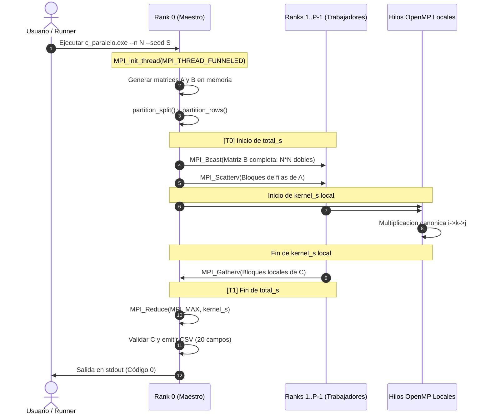
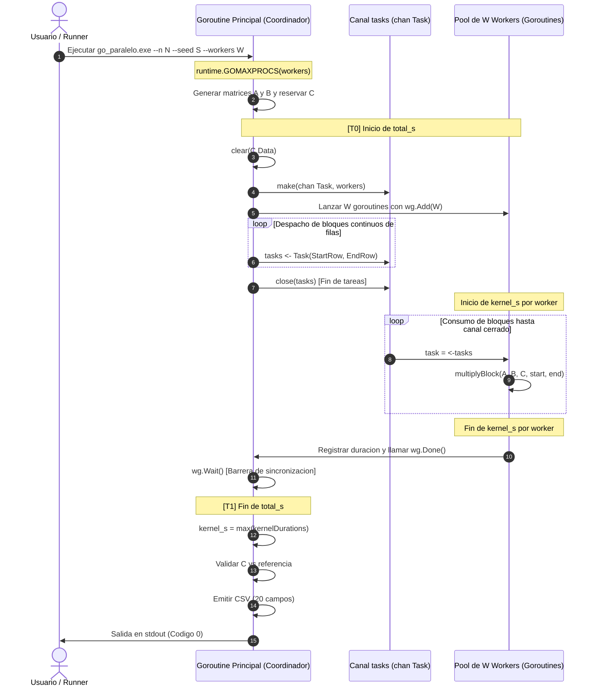

# Arquitectura de las Versiones Paralelas: C (MPI + OpenMP) y Go (Goroutines + Canales)

**Proyecto:** Multiplicación de Matrices Densas en C y Go (Windows 11)  
**Curso:** Programación Concurrente y Paralela — UNMSM  
**Sprint:** 4 (Semana 4)  
**Autor:** Integrante 8 — Roberto  
**Rama:** `feature/s04-i08-arquitectura-paralela`  
**Estado:** Documento de Arquitectura Actualizado · Modelos Reales, Flujos de Datos y Rúbrica  

---

## 1. Visión General y Paradigmas de Paralelismo

El objetivo central del proyecto es diseñar, implementar y comparar dos paradigmas fundamentales de computación paralela y concurrente para resolver la multiplicación de matrices densas cuadradas $C = A \times B$ de orden $N \times N$, sobre arquitectura multinúcleo x86_64 bajo Windows 11:

```
                               ARQUITECTURAS DEL PROYECTO
                                           │
         ┌─────────────────────────────────┴─────────────────────────────────┐
         ▼                                                                   ▼
   c_paralelo (Híbrido)                                            go_paralelo (CSP Concurrente)
   ┌───────────────────────────────────────────────┐               ┌───────────────────────────────────────────────┐
   │ Memoria Distribuida (MPI):                    │               │ Memoria Compartida (Go Runtime):              │
   │  • P procesos del S.O.                        │               │  • Pool acotado de W goroutines               │
   │  • Comunicación vía mensajes colectivos       │               │  • Planificador M:N sobre GOMAXPROCS hilos    │
   │  • Particionado 1D por bloques de filas       │               │  • Despacho por canal tipado chan Task        │
   │ Memoria Compartida (OpenMP):                  │               │ Sincronización y Propiedad:                   │
   │  • T hilos locales por proceso                │               │  • Sincronización limpia con sync.WaitGroup   │
   │  • Paralelismo de bucles (#pragma omp)        │               │  • Propiedad disjunta de escritura en C       │
   │  • Modo MPI_THREAD_FUNNELED                   │               │  • A y B solo lectura (cero data races)       │
   └───────────────────────────────────────────────┘               └───────────────────────────────────────────────┘
```

### Principios Rectores Comunes
1. **Representación de Datos:** Almacenamiento contiguo por filas (*row-major layout*) donde el elemento $(i, j)$ reside en la posición lineal $i \times N + j$. En C se utiliza `double` (64 bits, IEEE 754) y en Go `float64`.
2. **Núcleo Aritmético Canónico:** Orden de bucles $i \to k \to j$ en ambas implementaciones. Al fijar el elemento $A[i, k]$ en un registro/variable temporal, los accesos a las filas de $B$ y $C$ se realizan de forma estrictamente secuencial ($j$ consecutivo), maximizando la tasa de aciertos (*cache hits*) en las líneas de caché L1/L2.
3. **Propiedad Exclusiva de Escritura:** Cada celda $C[i, j]$ es modificada por exactamente un hilo o worker. No se requieren primitivas de exclusión mutua de grano fino (como mutex o bloqueos atómicos) en la sección crítica aritmética.
4. **Inmutabilidad de Entradas:** Las matrices $A$ y $B$ permanecen en solo lectura durante toda la computación; no sufren modificaciones ni se produce solapamiento destructivo (*buffer aliasing*).
5. **Separación de Intervalos Temporales:** Aislamiento estricto de `kernel_s` (tiempo de cómputo aritmético puro) frente a `total_s` (que incorpora vaciado de memoria, distribución de mensajes, despacho por canales y sincronización colectiva).

---

## 2. Arquitectura de C Paralelo (`c_paralelo`): Híbrido MPI + OpenMP

### 2.1. Modelo Jerárquico de Ejecución
La solución combina el paso de mensajes entre procesos independientes (**MPI**) con el paralelismo multihilo en memoria compartida (**OpenMP**), implementando el modelo jerárquico híbrido:

* **Nivel 1 (Entre Procesos - MPI):** El problema global se divide en $P$ procesos del sistema operativo comunicados mediante MS-MPI. El proceso maestro (`rank 0`) lee o genera las matrices, coordina la distribución y reúne los resultados.
* **Nivel 2 (Intra-proceso - OpenMP):** Cada proceso MPI utiliza $T$ hilos de ejecución OpenMP para computar su bloque asignado de filas en paralelo.
* **Nivel de Hilos MPI (`MPI_THREAD_FUNNELED`):** La inicialización se realiza con `MPI_Init_thread(..., MPI_THREAD_FUNNELED, &provided)`. Únicamente el hilo principal (*master thread*) de cada proceso ejecuta llamadas a funciones MPI, garantizando compatibilidad absoluta y ausencia de contención en la pila de red.

### 2.2. Particionado 1D por Bloques de Filas (`partition.h`)
Para repartir $N$ filas entre $P$ procesos cuando $N$ no es múltiplo exacto de $P$, se utiliza el algoritmo de cociente y resto en forma cerrada:

$$q = \lfloor N / P \rfloor, \quad r = N \bmod P$$

$$\text{filas}[i] = q + \begin{cases} 1 & \text{si } i < r \\ 0 & \text{si } i \ge r \end{cases}$$

$$\text{primera}[i] = i \times q + \min(i, r)$$

#### Invariantes Estructurales de Partición:
* **I1:** $\text{filas}[i] \ge 0 \quad \text{y} \quad \sum_{i=0}^{P-1} \text{filas}[i] = N$.
* **I2:** $\text{primera}[0] = 0$.
* **I3:** $\text{primera}[i+1] = \text{primera}[i] + \text{filas}[i]$ (bloques contiguos sin solapamiento ni huecos).
* **I4:** $\text{counts}[i] = \text{filas}[i] \times N$ (cantidad de elementos `double` transferidos por proceso).
* **I5:** $\text{displs}[i] = \text{primera}[i] \times N$ (desplazamiento en elementos dentro de la matriz plana).
* **I6:** $\sum_{i=0}^{P-1} \text{counts}[i] = N \times N$.
* **Soporte de $P > N$:** Si hay más procesos que filas ($q = 0, r = N$), los primeros $N$ procesos reciben 1 fila y los $P - N$ restantes reciben 0 filas (`counts[i] = 0`). La norma MPI estipula que `count = 0` es legal y no bloquea las llamadas colectivas.
* **Límite por Aritmética de Enteros:** Como los desplazamientos y conteos de MPI son enteros con signo (`int`), se exige $N \times N \le \text{INT\_MAX}$, lo que define el límite arquitectónico $N \le 46340$ ($\approx 17\text{ GB}$ por matriz en RAM).

### 2.3. Flujo de Datos y Comunicación Colectiva MPI
El intercambio de datos entre el proceso raíz (`rank 0`) y los procesos trabajadores se efectúa mediante tres operaciones colectivas sincronizadas:

```
                                 FLUJO DE COMUNICACIÓN MPI
 
       Proceso 0 (Raíz)                                          Procesos 0 .. P-1
   ┌───────────────────────┐                                   ┌───────────────────────┐
   │ Matriz A completa     │                                   │                       │
   │ Matriz B completa     │                                   │                       │
   └──────────┬────────────┘                                   └──────────┬────────────┘
              │                                                           │
              ├─────── MPI_Bcast(Matriz B completa: N*N elementos) ───────┤
              │        (Todos los procesos reciben la matriz B completa)  │
              │                                                           │
              ├─────── MPI_Scatterv(Matriz A: counts[], displs[]) ────────┤
              │        (Cada proceso i recibe filas[i]*N elementos de A)  │
              │                                                           ▼
              │                                                ┌───────────────────────┐
              │                                                │ Cálculo Local OpenMP  │
              │                                                │ #pragma omp parallel  │
              │                                                │ local_c = local_a * B │
              │                                                └──────────┬────────────┘
              │                                                           │
              ├─────── MPI_Gatherv(local_c: counts[], displs[]) ──────────┤
              │        (Proceso 0 recolecta los bloques locales de C)     │
              ▼                                                           ▼
   ┌───────────────────────┐                                   ┌───────────────────────┐
   │ Matriz C completa     │                                   │ local_c liberado      │
   │ Validación y CSV      │                                   │ Espera en MPI_Finalize│
   └───────────────────────┘                                   └───────────────────────┘
```

1. **Difusión Global de $B$ (`MPI_Bcast`):** Toda la matriz $B$ ($N \times N$ elementos `double`) se difunde a todos los procesos del comunicador `MPI_COMM_WORLD`. Como todos los procesos necesitan columnas completas de $B$, la difusión asegura que cada proceso disponga de $B$ localmente sin transferencias punto a punto adicionales.
2. **Distribución Segmentada de $A$ (`MPI_Scatterv`):** El proceso 0 dispersa la matriz $A$ según el vector `counts` y `displs`. El proceso $i$ almacena su porción en un buffer local continuo `local_a` de tamaño $\text{filas}[i] \times N$.
3. **Recolección Segmentada de $C$ (`MPI_Gatherv`):** Tras completar la multiplicación local, cada proceso envía su buffer continuo `local_c` ($\text{filas}[i] \times N$ dobles). El proceso 0 reconstruye la matriz $C$ en el buffer global ordenado.

### 2.4. Paralelismo Multihilo Local con OpenMP
En cada proceso con $\text{filas}[\text{rank}] > 0$, el cálculo del producto se distribuye entre los hilos del proceso mediante directivas OpenMP:

```c
#pragma omp parallel for schedule(static) default(none) \
    shared(local_a, b, local_c, local_rows, n) private(i, k, j, a_ik)
for (int i = 0; i < local_rows; ++i) {
    const double *a_row = local_a + (size_t)i * n;
    double *c_row = local_c + (size_t)i * n;
    for (int k = 0; k < n; ++k) {
        const double a_ik = a_row[k];
        const double *b_row = b + (size_t)k * n;
        for (int j = 0; j < n; ++j) {
            c_row[j] += a_ik * b_row[j];
        }
    }
}
```

* **`schedule(static)`:** Distribuye las filas locales en bloques uniformes entre los hilos de manera determinista, minimizando la sobrecarga de despacho dinámico.
* **Aislamiento de Variables:** Las variables de control de bucle `i`, `k`, `j` y el escalar `a_ik` se declaran `private` por hilo en la pila (*thread stack*). Los punteros de matriz `local_a`, `b` y `local_c` son `shared`.
* **Cero Colisiones de Escritura:** Dado que el bucle paralelizado es el exterior (`i`), cada hilo opera en un conjunto disjunto de filas de `local_c`. Dos hilos jamás acceden a la misma posición de memoria en escritura.

### 2.5. Delimitación Temporal en C Paralelo
* **`kernel_s`:** Intervalo medido exclusivamente alrededor del bloque de cálculo OpenMP (`local_rows > 0`). El proceso raíz recopila mediante `MPI_Reduce` con operador `MPI_MAX` el tiempo del proceso más lento:
  $$\text{kernel\_s} = \max_{p \in [0, P-1]} (\text{kernel\_s}_p)$$
* **`total_s`:** Cronometrado por el proceso 0 desde antes de `MPI_Bcast` y `MPI_Scatterv`, abarcando la inicialización de buffers locales, el cómputo y la sincronización final con `MPI_Gatherv`.

---

## 3. Arquitectura de Go Paralelo (`go_paralelo`): Goroutines y Canales

### 3.1. Modelo CSP (Communicating Sequential Processes)
`go_paralelo` reemplaza la memoria distribuida por un modelo de concurrencia estructurada sobre memoria compartida administrada por el runtime de Go:

* **Pool Acotado de Goroutines:** No se genera una goroutine por celda ni por fila. Se inicializa un pool fijo de exactamente $W$ workers (`--workers W`).
* **Canal Tipado de Tareas (`chan Task`):** Las goroutines trabajadoras compiten de forma pasiva por consumir tareas de un canal tipado con buffer acotado (`make(chan Task, workers)`).
* **Coordinación de Finalización:** Sincronización libre de cerrojos mediante `sync.WaitGroup` (`wg.Add`, `defer wg.Done()`, `wg.Wait()`).
* **Runtime M:N:** Se fija `runtime.GOMAXPROCS(workers)` para permitir ejecución verdaderamente simultánea sobre los hilos del sistema operativo.

### 3.2. Estructuras de Datos y Modelo de Tareas (`workers.go`)
```go
// Matrix representa una matriz cuadrada en almacenamiento continuo por filas
type Matrix struct {
    N    int
    Data []float64 // len == N*N, fila i en Data[i*N : (i+1)*N]
}

// Task delimita un intervalo contiguo de filas semi-abierto [StartRow, EndRow)
type Task struct {
    StartRow int // 0 <= StartRow < EndRow <= N
    EndRow   int
}
```

#### Particionado Dinámico por Bloques (`computeBlockSize` y `dispatchRowBlocks`):
El orquestador calcula el tamaño de bloque mediante división por exceso protegida contra desbordamientos:
```go
func computeBlockSize(n, workers int) int {
    size := n / workers
    if n%workers != 0 {
        size++
    }
    return size
}
```
* Si $W \ge N$: `size = 1`. Cada tarea contiene exactamente una fila. Las primeras $N$ goroutines reciben trabajo y las $W - N$ restantes no reciben tareas y terminan limpiamente al cerrarse el canal.
* El productor (goroutine principal) despacha todos los bloques e inmediatamente ejecuta `close(tasks)`.

### 3.3. Ciclo de Vida del Worker y Ejecución Aritmética
```
                                 FLUJO CONCURRENTE EN GO
 
        Goroutine Coordinadora                                     Pool de W Workers
   ┌──────────────────────────────┐                          ┌───────────────────────────┐
   │ 1. Validar A y B             │                          │ Worker 0 (goroutine)      │
   │ 2. Reservar C (N*N doubles)  │                          │ Worker 1 (goroutine)      │
   │ 3. tasks := make(chan Task)  │                          │ ...                       │
   │ 4. wg.Add(W); lanzar workers │                          │ Worker W-1 (goroutine)    │
   └──────────────┬───────────────┘                          └─────────────┬─────────────┘
                  │                                                        │
                  ├──────── Despacho de bloques a tasks <- Task ───────────┤
                  │         (Cada bloque [StartRow, EndRow) es continuo)   │
                  │                                                        ▼
                  ├──────── close(tasks) [Señal de no más trabajo] ────────┤
                  │                                                        │
                  │                                          ┌───────────────────────────┐
                  │                                          │ for task := range tasks { │
                  │                                          │   t0 := time.Now()        │
                  │                                          │   multiplyBlock(a,b,c)    │
                  │                                          │   dur += Since(t0)        │
                  │                                          │ }                         │
                  │                                          │ kernelDurations[id] = dur │
                  │                                          │ defer wg.Done()           │
                  │                                          └─────────────┬─────────────┘
                  │                                                        │
                  ├──────── wg.Wait() [Barrera de sincronización] ─────────┤
                  ▼                                                        ▼
   ┌──────────────────────────────┐                          ┌───────────────────────────┐
   │ 5. total_s = time.Since(T0)  │                          │ Workers finalizados       │
   │ 6. kernel_s = max(durations) │                          │                           │
   │ 7. Validación numérica y CSV │                          │                           │
   └──────────────────────────────┘                          └───────────────────────────┘
```

```go
func worker(id int, tasks <-chan Task, wg *sync.WaitGroup,
    a, b, c *Matrix, kernelDurations []time.Duration) {
    defer wg.Done()
    var elapsed time.Duration
    for task := range tasks {
        start := time.Now()
        multiplyBlock(a, b, c, task.StartRow, task.EndRow)
        elapsed += time.Since(start)
    }
    kernelDurations[id] = elapsed // Escritura en slot propio disjunto
}
```

* **`multiplyBlock`:** Implementa el triple bucle $i \to k \to j$ exclusivamente en el rango $[StartRow, EndRow)$.
* **Propiedad de Memoria:** $A$ y $B$ se acceden concurrentemente sin sincronización porque son 100% de solo lectura. En $C$, cada worker escribe en su segmento disjunto $Data[StartRow \times N : EndRow \times N]$. No existe solapamiento ni carreras de datos (*race-free*).
* **Inspección Dinámica de Carreras:** Verificado formalmente con el runtime de detección de condiciones de carrera: `go test -race ./...`.

### 3.4. Delimitación Temporal en Go Paralelo
* **`kernel_s`:** Se instrumenta individualmente dentro de cada worker midiendo solo el tiempo acumulado en `multiplyBlock`. Al salir de `wg.Wait()`, la coordinadora toma el valor máximo:
  $$\text{kernel\_s} = \max_{w \in [0, W-1]} (\text{kernelDurations}[w])$$
* **`total_s`:** Cronometrado por el coordinador abarcando el vaciado explícito de $C$ (`clear(c.Data)`), creación del canal, lanzamiento del pool de workers, despacho de bloques, espera en `wg.Wait()` y cálculo de métricas.

---

## 4. Comparación Arquitectónica: C Paralelo vs Go Paralelo

| Dimensión Técnica | C Paralelo (`c_paralelo`) | Go Paralelo (`go_paralelo`) |
| :--- | :--- | :--- |
| **Paradigma Principal** | Paso de mensajes distribuido + Hilos nativos | Concurrencia CSP basada en canales + Goroutines |
| **Tecnologías** | MS-MPI (v10+) + OpenMP (C11, MSVC x64) | Go Runtime nativo (Go 1.27+ `windows/amd64`) |
| **Espacio de Direcciones** | $P$ procesos con memoria aislada (distribuida) | 1 proceso con heap único compartido |
| **Distribución de Matriz $A$** | `MPI_Scatterv` (bloques contiguos por filas) | `chan Task` (despacho de bloques de filas) |
| **Distribución de Matriz $B$** | `MPI_Bcast` (réplica completa en cada proceso) | Memoria compartida global (solo lectura sin copia) |
| **Recolección de Matriz $C$** | `MPI_Gatherv` (reconstrucción en rank 0) | Escritura directa en slice `C.Data` |
| **Granularidad de Hilos** | $T$ hilos OS del sistema operativo por proceso | $W$ goroutines ligeras mapeadas por scheduler M:N |
| **Sincronización** | Colectivas bloqueantes (`MPI_Bcast`, `MPI_Gatherv`) | Canal tipado + `sync.WaitGroup` |
| **Sobrecarga de Comunicación** | Serialización y copia por sockets/memoria compartida IPC | Cero copia de datos; solo paso del descriptor `Task` (16 bytes) |
| **Prevención de Data Races** | Procesos aislados; OpenMP privatiza índices $i,k,j$ | Rango de filas disjunto en $C$; $A, B$ solo lectura |
| **Comportamiento si $P > N$ o $W > N$** | Procesos extra reciben `count=0` sin fallos | Goroutines extra no reciben tareas y salen con `wg.Done()` |
| **Escalabilidad Teórica** | Escala a clústeres multi-nodo y supercomputadores | Escala eficientemente dentro de un nodo simétrico (SMP/NUMA) |

---

## 5. Mapeo a la Rúbrica de Evaluación y Criterios Académicos

En conformidad con las pautas de evaluación del curso de **Programación Concurrente y Paralela**, las dos arquitecturas satisfacen los siguientes pilares de rigor:

### 5.1. Corrección Matemática y Determinismo Numérico
* **Tolerancia Universal:** Ambas referencias implementan la regla estricta de validación celda a celda contra fixtures de control (`tests/fixtures/`):
  $$|C_{\text{obtenido}} - C_{\text{esperado}}| \le 10^{-9} + 10^{-9} \cdot |C_{\text{esperado}}|$$
* **Generación Idéntica:** El generador pseudoaleatorio congruencial lineal (LCG) genera matrices idénticas bit a bit en C y Go partiendo de la misma semilla (`--seed`).

### 5.2. Seguridad Concurrente y Ausencia de Anomalías
* **Ausencia de Deadlocks:**
  * En C: las llamadas colectivas (`Bcast`, `Scatterv`, `Gatherv`) son invocadas en idéntico orden y cardinalidad por todos los procesos de `MPI_COMM_WORLD`.
  * En Go: el productor asegura `close(tasks)` únicamente tras despachar la totalidad de los bloques, permitiendo que todos los workers salgan del bucle `for task := range tasks`.
* **Ausencia de Data Races:**
  * En C: ningún hilo OpenMP comparte índices de fila de escritura.
  * En Go: garantizado por diseño e inspección estática y dinámica con `go test -race`.

### 5.3. Rigor del Protocolo Experimental
* **Aislamiento de Cronometraje:** La lectura de archivos, validación sintáctica de flags, generación de matrices y emisión de salidas CSV se ejecutan fuera de los cronómetros.
* **Separación `kernel_s` vs `total_s`:** Permite calcular el *overhead* de paralelización ($\text{Sobrecarga} = \text{total\_s} - \text{kernel\_s}$), revelando el costo de la comunicación de red/IPC en MPI frente a la contención del planificador en Go.

---

## 6. Diagramas de Flujo y Secuencia

### 6.1. Secuencia de Comunicación en C Paralelo (`c_paralelo`)


### 6.2. Secuencia de Concurrencia en Go Paralelo (`go_paralelo`)


---

## 7. Invariantes de Correctitud Globales

| Invariante | Descripción | Implementación en C (`c_paralelo`) | Implementación en Go (`go_paralelo`) |
| :---: | :--- | :--- | :--- |
| **INV-01** | **Cobertura Completa:** Toda fila $i \in [0, N-1]$ se calcula exactamente una vez. | Garantizado por `partition_split`: $\sum \text{filas}[i] = N$ y bloques adyacentes. | Garantizado por `dispatchRowBlocks`: bloques contiguos disjuntos cubren $[0, N)$. |
| **INV-02** | **Aislamiento de Escritura:** Ningún hilo/proceso sobreescribe memoria de otro. | Cada proceso escribe en su `local_c`; OpenMP particiona el bucle exterior $i$. | Cada worker escribe en $C[StartRow \times N : EndRow \times N]$; no hay solapamiento. |
| **INV-03** | **Inmutabilidad de Entrada:** $A$ y $B$ no sufren alteraciones durante el cómputo. | Punteros `const double *` en OpenMP; buffers independientes. | Slices $A$ y $B$ tratados como solo lectura; verificado con `reflect.DeepEqual`. |
| **INV-04** | **Terminación Garantizada:** Ausencia de bloqueos (*deadlocks*) en sincronización. | Mismo orden de colectivas MPI en todos los procesos; $P > N$ manejado con `count=0`. | `close(tasks)` ejecutado tras despachar todo; workers salen del `range` y llaman `Done()`. |
| **INV-05** | **Robustez Numérica:** Rechazo inmediato ante valores no finitos o desbordamientos. | Validación con `isfinite()`; control de $N \le 46340$ en `partition_rows`. | Validación con `math.IsNaN()` / `math.IsInf()`; error explícito `ErrNonFiniteValue`. |

---

## 8. Trazabilidad con la Guía del Proyecto y Entregables

* **`c_paralelo/include/partition.h`:** Contrato matemático de particionado 1D (Sebastian, S2).
* **`c_paralelo/src/main.c` y `partition.c`:** Orquestación de llamadas colectivas MPI (Yessly, S4).
* **`c_paralelo/src/matrix.c`:** Computación local con OpenMP (Sebastian, S4).
* **`go_paralelo/workers.go` y `matrix.go`:** Pool de goroutines, canal tipado y `multiplyBlock` (Giuliano, S4).
* **`go_paralelo/main.go`:** Integración de CLI, temporizadores y CSV (Eva, S4).
* **`docs/protocolo_medicion.md`:** Protocolo oficial de cronometraje y esquema CSV de 20 campos (Andrés, S2).
* **`docs/bibliografia.md`:** Fundamento teórico de localidad de caché y particionado por filas (Roberto, S2).

---

## 9. Conclusión de Arquitectura

La arquitectura de ambas referencias paralelas ha sido diseñada bajo una estricta paridad matemática y estructural:
1. Ambas aplican particionado horizontal por bloques de filas y acumulación canónica $i \to k \to j$.
2. Ambas garantizan inmunidad contra condiciones de carrera mediante propiedad disjunta de memoria.
3. Ambas desacoplan la comunicación y sincronización del cómputo puro, permitiendo mediciones científicas comparables de `kernel_s` y `total_s` conforme al protocolo del curso.
